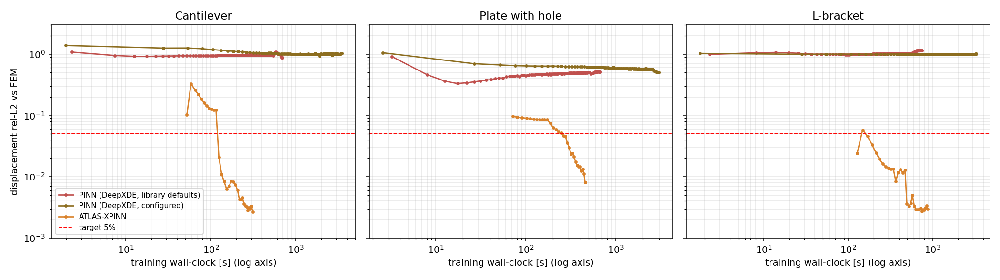
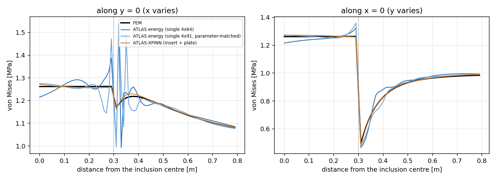

# ATLAS: every result for the six benchmarks

This file collects every number the project has for its six benchmarks.

| group | benchmarks |
|---|---|
| Paper benchmarks | cantilever beam, plate with a circular hole, L-shaped bracket |
| Multi-material benchmarks | steel insert in an aluminium plate, plate with a soft circular inclusion, epoxy-filled elliptical slot |

It covers seed-42 comparisons, five-seed studies, inverse design, convergence and timing, FEM references, and the
web console's live solver.

Each value is copied or computed from the files named in [section 7](#7-where-every-number-comes-from).

Status: repository `main` at `6e2faae`, written 2026-09-29.

## Contents

1. [Headline results](#1-headline-results)
2. [Setup: hardware, solvers, metrics, protocol](#2-setup)
3. [Paper benchmarks](#3-paper-benchmarks)
4. [Multi-material benchmarks](#4-multi-material-benchmarks)
5. [Web console live solver](#5-web-console-live-solver)
6. [Caveats and data-quality notes](#6-caveats-and-data-quality-notes)
7. [Where every number comes from](#7-where-every-number-comes-from)
8. [Reproduce](#8-reproduce)
9. [References](#9-references)

---

## 1. Headline results

**Targets:** displacement error below 5 % and von Mises error below 10 %, both relative L2 against FEniCS.
FEM data is never used in training.

### 1.1 Paper benchmarks (five seeds, 42-46)

| benchmark | ATLAS-XPINN displacement | ATLAS-XPINN von Mises (excl.) | ATLAS energy (single) displacement | ATLAS energy von Mises (excl.) | best DeepXDE PINN (seed 42) |
|---|---|---|---|---|---|
| Cantilever beam | 0.253 ± 0.024 % | 2.14 ± 0.10 % | 0.156 ± 0.018 % | 2.01 ± 0.09 % | 87.8 % / 89.9 % |
| Plate with hole | 0.405 ± 0.241 % | 2.89 ± 0.33 % | 0.187 ± 0.004 % | 2.58 ± 0.01 % | 41.9 % / 31.7 % |
| L-bracket | 0.254 ± 0.024 % | 4.54 ± 0.07 % | 0.185 ± 0.001 % | 4.18 ± 0.02 % | 84.2 % / 82.0 % |

- All 30 ATLAS runs pass both targets.
- Neither DeepXDE baseline (library defaults or configured) passes either target on any benchmark.
- On these single-material benchmarks the single network is slightly more accurate than ATLAS-XPINN.

### 1.2 Multi-material benchmarks (five seeds, 42-46)

ATLAS-XPINN is compared with the better of two single networks, one of them parameter-matched.

| benchmark | ATLAS-XPINN displacement | single displacement | ATLAS-XPINN von Mises | single von Mises | verdict |
|---|---|---|---|---|---|
| Steel insert | **0.021 ± 0.003 %** | 0.063 ± 0.014 % | **0.118 ± 0.004 %** | 1.219 ± 0.217 % | ATLAS-XPINN better in all 5 seeds: displacement 3.0x, von Mises **10.3x** lower |
| Soft inclusion (contrast 15) | **0.047 ± 0.018 %** | 0.153 ± 0.021 % | **0.325 ± 0.091 %** | 0.635 ± 0.114 % | ATLAS-XPINN better in all 5 seeds: displacement 3.3x, von Mises 2.0x lower |
| Filled slot | **0.058 ± 0.009 %** | 0.222 ± 0.037 % | **0.467 ± 0.104 %** | 0.531 ± 0.064 % | displacement 3.8x lower in all 5 seeds; von Mises a statistical tie (p ≈ 0.3) |

ATLAS-XPINN also trains in about two thirds of the time of the parameter-matched single network (360-377 s against
549-599 s).

---

## 2. Setup

### 2.1 Hardware and software

| item | value |
|---|---|
| GPU | NVIDIA GeForce RTX 2050 laptop, 4 GB (throttles near 88 °C); one training job at a time |
| CPU / RAM | 12 threads; WSL2 with about 3 GB RAM, so FEM meshes are kept at about 120k P2 cells or fewer |
| OS | Linux 6.18 (WSL2) |
| Python stack | Python 3.10, torch 2.11.0 (CUDA 12.8), numpy 1.26.4, matplotlib 3.10.9, deepxde 1.15.0 |
| FEM | FEniCS (legacy dolfin) 2019.1.0 with mshr, conda env `Atlas` |
| Web | fastapi 0.141.1, uvicorn 0.52.4, pydantic 2.13.5 |
| Precision | ATLAS solvers train in float64 on the GPU |

### 2.2 Solvers

| name | what it is | parameters |
|---|---|---|
| **ATLAS energy** (single network) | Deep-energy (Ritz) method (Samaniego et al., 2020): minimises the total potential energy `½∫σ:ε − ∫t·u`. Essential BCs are exact through `u = mask(x)·net(x)`. Graded Gauss-Legendre quadrature, with polar O-grid blocks around holes. One 4×64 tanh network. The L-bracket adds a re-entrant-corner enrichment with Williams' (1952) exponents (λ = 0.5445, 0.9085). | 12,802 (L-bracket 12,826) |
| **ATLAS energy, wide** (4×91) | The same single network, widened to match ATLAS-XPINN's parameter count (capacity control, multi-material benchmarks). | 25,573 |
| **ATLAS-XPINN** | The same energy formulation, domain-decomposed as an XPINN (Jagtap & Karniadakis, 2020). It uses one 4×64 tanh subnetwork per subdomain, with displacement and traction continuity at the interfaces. | 25,604 (2 subdomains); 38,406 (3); 38,478 (L-bracket, 3 + enrichment) |
| PINN (DeepXDE, library defaults) | An independent open-source baseline (Lu et al., 2021): one tanh network, soft BCs, library-default loss weights. It trains 10,000 Adam + 2,000 L-BFGS steps in float32. | 12,802 |
| PINN (DeepXDE, configured) | DeepXDE with settings fixed in advance from standard practice, never chosen by FEM error. Essential BCs are exact through an output transform, it runs in float64, adds collocation points at the stress concentration, and balances loss weights from the initial losses. | 12,802 |
| Standard PINN (in-house) | A strong-form residual loss on one network (Raissi et al., 2019), with parameters matched to ATLAS-XPINN. | 25,573 / 37,853 |

**ATLAS-XPINN default recipe:** the same for all six benchmarks and never tuned per benchmark.

| setting | value |
|---|---|
| Budget | 2000 Adam then 2000 L-BFGS, the same as ATLAS energy |
| Warm start | the first 1000 Adam steps train one network on the whole domain, which is then copied into every subnetwork |
| Interface coupling | augmented Lagrangian with 3 multiplier updates, splitting the L-BFGS budget into 4 parts |
| Penalty weights | γ_u = 30 (displacement continuity), γ_t = 0.1 (traction continuity) |
| Interface weight scaling | the stiffest material present |
| Input normalisation | global (each subnetwork sees the whole domain's coordinate range) |

Subdomain layouts:

| benchmark | subdomains |
|---|---|
| Cantilever | 2: split at x = L/2 |
| Plate with hole | 3: rings split at ρ = r + 0.3 and ρ = r + 0.6 |
| L-bracket | 3: the three unit squares of the L |
| Multi-material | 2: one per material; the interface is the material boundary |

### 2.3 Metrics

| metric | definition |
|---|---|
| Displacement L2 | For the paper benchmarks, the relative L2 of the displacement magnitude √(u²+v²) at the FEM nodes (the `atlas.validation` metric); the vector (u, v) version is also reported. For the multi-material benchmarks, the relative L2 of the vector field on a 0.01 m grid. |
| von Mises L2 (excl.) | Relative L2 of von Mises stress, excluding a small disc around each singular point (radius 0.031 m cantilever, 0.018 m plate, 0.022 m L-bracket). The multi-material benchmarks have no singular points and exclude nothing. |
| Interface band | von Mises relative L2 on a 0.0025 m grid within 0.05 m of the material interface, reported separately for each side. |
| Compliance | C = ∫ t·u ds over the loaded edge; error relative to FEM (spec target: within 10 %). |
| Max pointwise | The worst single node, as a percentage of the FEM maximum of that field. This is a worst-case indicator, not a pass/fail metric. |
| Seed statistics | mean ± sample standard deviation (ddof = 1) over seeds 42-46. |

### 2.4 Pre-registered protocol (multi-material)

Each multi-material benchmark had a `PROTOCOL.md` written before its first training run.

1. **Seed 42:** run the 4×64 single network, ATLAS-XPINN and the parameter-matched 4×91 single network.
2. **Condition to continue:** ATLAS-XPINN must have lower displacement AND lower von Mises error than BOTH single networks.
3. **Five seeds:** only then, run seeds 42-46 for ATLAS-XPINN and the better single network. The claim stands if both 5-seed means are lower.
4. **Fairness:** all solvers use the same 12,960 quadrature points and the same budget (2000 Adam + 2000 L-BFGS). One GPU job runs at a time.

---

## 3. Paper benchmarks

### 3.1 Problem definitions (plane stress, E = 210 GPa, ν = 0.3)

| benchmark | geometry | supports | load |
|---|---|---|---|
| Cantilever beam | [0, 4] × [0, 1] m | clamped at x = 0 | parabolic shear on x = 4: t_y = 6(P/H)(y/H)(1 − y/H), P = −1 MN/m |
| Plate with circular hole | quarter plate [0, 2]², hole r = 0.3 m at the origin | symmetry rollers on x = 0, y = 0 | uniform tension 1 MPa on x = 2 |
| L-shaped bracket | L with corners (0,0), (2,0), (2,2), (1,2), (1,1), (0,1) m; re-entrant corner at (1, 1) | clamped at x = 0 | parabolic t_x = 6P·s(1 − s), s = y − 1, on x = 2 for y ∈ [1, 2], P = 1 MN/m |

FEM reference: FEniCS P2, never used in training. The reference compliances are 1272 N·m (cantilever), 20.14 N·m
(plate) and 96.52 N·m (L-bracket). The L-bracket value is node-sampled; the converged value is 96.97, see
[section 6](#6-caveats-and-data-quality-notes).

### 3.2 All solvers, seed 42

| benchmark | solver | displacement (magnitude) | displacement (vector) | von Mises (excl.) | compliance [N·m] | compliance vs FEM | params | train time |
|---|---|---|---|---|---|---|---|---|
| Cantilever | Standard PINN (in-house) | 9.51 % | 191.03 % | 20.91 % | −1112 | −187.45 % | 25,573 | 16.8 min |
| Cantilever | PINN (DeepXDE, defaults) | 87.79 % | 88.09 % | 89.92 % | 132 | −89.63 % | 12,802 | 11.6 min |
| Cantilever | PINN (DeepXDE, configured) | 97.16 % | 102.57 % | 93.30 % | −32.25 | −102.54 % | 12,802 | 58.0 min |
| Cantilever | ATLAS energy (single) | **0.19 %** | 0.19 % | 2.29 % | 1270 | −0.17 % | 12,802 | 4.3 min |
| Cantilever | ATLAS-XPINN | 0.27 % | 0.27 % | **2.10 %** | 1269 | −0.22 % | 25,604 | 5.0 min |
| Plate with hole | Standard PINN (in-house) | 40.58 % | 47.12 % | 30.89 % | 15.81 | −21.51 % | 37,853 | 20.6 min |
| Plate with hole | PINN (DeepXDE, defaults) | 41.85 % | 51.42 % | 31.66 % | 15.54 | −22.83 % | 12,802 | 11.1 min |
| Plate with hole | PINN (DeepXDE, configured) | 44.22 % | 50.50 % | 33.60 % | 15.26 | −24.24 % | 12,802 | 50.1 min |
| Plate with hole | ATLAS energy (single) | **0.19 %** | 0.21 % | **2.58 %** | 20.12 | −0.06 % | 12,802 | 4.5 min |
| Plate with hole | ATLAS-XPINN | 0.75 % | 0.81 % | 3.39 % | 20.09 | −0.23 % | 38,406 | 7.3 min |
| L-bracket | Standard PINN (in-house) | 51.73 % | 56.63 % | 70.82 % | 29.08 | −69.87 % | 37,853 | 25.8 min |
| L-bracket | PINN (DeepXDE, defaults) | 84.15 % | 115.18 % | 81.97 % | −6.296 | −106.52 % | 12,802 | 12.4 min |
| L-bracket | PINN (DeepXDE, configured) | 98.88 % | 100.52 % | 94.45 % | 2.394 | −97.52 % | 12,802 | 54.6 min |
| L-bracket | ATLAS energy (single) | **0.19 %** | 0.27 % | **4.20 %** | 96.93 | +0.42 % | 12,826 | 10.1 min |
| L-bracket | ATLAS-XPINN | 0.22 % | 0.30 % | 4.55 % | 96.89 | +0.38 % | 38,478 | 14.5 min |

- **ATLAS energy train times:** these come from the timing run in [section 3.5](#35-convergence-and-processing-time-seed-42). The stored forward runs carry no timing.
- **Stored cantilever single-network run:** it is a CPU run. The GPU run of the same seed gives 0.17 % / 2.17 %.
- **Standard PINN sign flip:** its cantilever solution is sign-flipped. The magnitude metric reads 9.5 % while the vector metric reads 191 %.

### 3.3 Compliance difference and pointwise maxima, seed 42

| benchmark | solver | C − C_FEM [N·m] | max pointwise displacement error | max pointwise von Mises error | at (x, y) |
|---|---|---|---|---|---|
| Cantilever | Standard PINN (in-house) | −2385 | 187.21 % | 42.41 % (1.79e7 Pa) | (0.000, 1.000) |
| Cantilever | PINN (DeepXDE, defaults) | −1140 | 90.09 % | 97.24 % (4.11e7 Pa) | (0.000, 1.000) |
| Cantilever | PINN (DeepXDE, configured) | −1304 | 102.73 % | 98.05 % (4.14e7 Pa) | (0.000, 1.000) |
| Cantilever | ATLAS energy (single) | −2.212 | 0.33 % | 35.85 % (1.52e7 Pa) | (0.000, 1.000) |
| Cantilever | ATLAS-XPINN | −2.814 | 0.38 % | 43.26 % (1.83e7 Pa) | (0.000, 1.000) |
| Plate with hole | Standard PINN (in-house) | −4.331 | 60.73 % | 88.32 % (4.96e6 Pa) | (0.000, 0.313) |
| Plate with hole | PINN (DeepXDE, defaults) | −4.597 | 65.99 % | 89.09 % (5.00e6 Pa) | (0.000, 0.313) |
| Plate with hole | PINN (DeepXDE, configured) | −4.881 | 71.32 % | 88.16 % (4.95e6 Pa) | (0.000, 0.313) |
| Plate with hole | ATLAS energy (single) | −0.01232 | 5.54 % | 50.60 % (2.84e6 Pa) | (0.007, 0.300) |
| Plate with hole | ATLAS-XPINN | −0.04641 | 5.39 % | 53.60 % (3.01e6 Pa) | (0.000, 0.313) |
| L-bracket | Standard PINN (in-house) | −67.44 | 61.72 % | 99.69 % (2.65e7 Pa) | (1.000, 1.000) |
| L-bracket | PINN (DeepXDE, defaults) | −102.8 | 114.16 % | 99.03 % (2.63e7 Pa) | (1.000, 1.000) |
| L-bracket | PINN (DeepXDE, configured) | −94.13 | 100.72 % | 99.44 % (2.64e7 Pa) | (1.000, 1.000) |
| L-bracket | ATLAS energy (single) | +0.4044 | 1.14 % | 89.02 % (2.36e7 Pa) | (1.000, 1.000) |
| L-bracket | ATLAS-XPINN | +0.3642 | 1.16 % | 63.71 % (1.69e7 Pa) | (1.000, 1.000) |

The von Mises maxima sit at the clamp corner, the hole edge and the re-entrant corner. The FEM reference is least
reliable at those points.

### 3.4 Five-seed repeatability (seeds 42-46, 2000 Adam + 2000 L-BFGS)

Displacement is the magnitude metric; von Mises excludes the singular region. All 30 runs pass both targets.

**ATLAS-XPINN**

| benchmark | seed 42 | seed 43 | seed 44 | seed 45 | seed 46 | mean ± std |
|---|---|---|---|---|---|---|
| Cantilever, displacement | 0.268 % | 0.238 % | 0.246 % | 0.287 % | 0.225 % | 0.253 ± 0.024 % |
| Cantilever, von Mises | 2.096 % | 2.180 % | 2.138 % | 2.270 % | 2.010 % | 2.14 ± 0.10 % |
| Plate, displacement | 0.754 % | 0.207 % | 0.559 % | 0.225 % | 0.280 % | 0.405 ± 0.241 % |
| Plate, von Mises | 3.387 % | 2.618 % | 3.059 % | 2.697 % | 2.666 % | 2.89 ± 0.33 % |
| L-bracket, displacement | 0.219 % | 0.275 % | 0.278 % | 0.248 % | 0.249 % | 0.254 ± 0.024 % |
| L-bracket, von Mises | 4.552 % | 4.614 % | 4.455 % | 4.605 % | 4.467 % | 4.54 ± 0.07 % |

**ATLAS energy (single network)**

| benchmark | seed 42 | seed 43 | seed 44 | seed 45 | seed 46 | mean ± std |
|---|---|---|---|---|---|---|
| Cantilever, displacement | 0.168 % | 0.167 % | 0.130 % | 0.145 % | 0.170 % | 0.156 ± 0.018 % |
| Cantilever, von Mises | 2.174 % | 1.993 % | 1.939 % | 1.997 % | 1.955 % | 2.01 ± 0.09 % |
| Plate, displacement | 0.186 % | 0.193 % | 0.183 % | 0.188 % | 0.187 % | 0.187 ± 0.004 % |
| Plate, von Mises | 2.581 % | 2.566 % | 2.578 % | 2.587 % | 2.579 % | 2.58 ± 0.01 % |
| L-bracket, displacement | 0.186 % | 0.184 % | 0.184 % | 0.187 % | 0.185 % | 0.185 ± 0.001 % |
| L-bracket, von Mises | 4.204 % | 4.180 % | 4.158 % | 4.175 % | 4.180 % | 4.18 ± 0.02 % |

Von Mises without the exclusion, 5-seed means (XPINN / single):

| benchmark | ATLAS-XPINN | single |
|---|---|---|
| Cantilever | 3.05 % | 2.70 % |
| Plate | 2.97 % | 2.69 % |
| L-bracket | 6.91 % | 7.62 % |

### 3.5 Convergence and processing time (seed 42)

Errors are probed against FEM during training for monitoring only; probe time is excluded from the clock.
Displacement here is the vector L2. "Time to X" is the first probe after which the error stays below X.

| benchmark | solver | params | train time | s / iteration | final displacement | final von Mises (excl.) | time to 5 % | time to 1 % | iterations to 5 % / 1 % |
|---|---|---|---|---|---|---|---|---|---|
| Cantilever | PINN (DeepXDE, defaults) | 12,802 | 695 s | 0.058 | 88.09 % | 89.92 % | never | never | - |
| Cantilever | PINN (DeepXDE, configured) | 12,802 | 3479 s | 0.290 | 102.57 % | 93.30 % | never | never | - |
| Cantilever | ATLAS energy (single) | 12,802 | 257 s | 0.064 | 0.136 % | 2.05 % | 83 s | 120 s | 1700 / 2300 |
| Cantilever | ATLAS-XPINN | 25,604 | 311 s | 0.078 | 0.27 % | 2.10 % | 124 s | 143 s | 2100 / 2300 |
| Plate with hole | PINN (DeepXDE, defaults) | 12,802 | 666 s | 0.055 | 51.42 % | 31.66 % | never | never | - |
| Plate with hole | PINN (DeepXDE, configured) | 12,802 | 3009 s | 0.251 | 50.50 % | 33.60 % | never | never | - |
| Plate with hole | ATLAS energy (single) | 12,802 | 270 s | 0.067 | 0.204 % | 2.58 % | 108 s | 123 s | 2100 / 2300 |
| Plate with hole | ATLAS-XPINN | 38,406 | 455 s | 0.114 | 0.81 % | 3.39 % | 261 s | 455 s | 2600 / 4000 |
| L-bracket | PINN (DeepXDE, defaults) | 12,802 | 746 s | 0.062 | 115.18 % | 81.97 % | never | never | - |
| L-bracket | PINN (DeepXDE, configured) | 12,802 | 3277 s | 0.273 | 100.52 % | 94.45 % | never | never | - |
| L-bracket | ATLAS energy (single) | 12,826 | 605 s | 0.151 | 0.264 % | 4.16 % | 57 s | 283 s | 400 / 2100 |
| L-bracket | ATLAS-XPINN | 38,478 | 875 s | 0.219 | 0.30 % | 4.55 % | 169 s | 495 s | 1200 / 2600 |

The DeepXDE runs use 10,000 Adam + 2,000 L-BFGS steps. The ATLAS runs use 2,000 Adam + 2,000 L-BFGS.

Final total potential energy (solver units; lower is closer to the exact minimum for a conforming field):

| benchmark | single | XPINN |
|---|---|---|
| Cantilever | −0.521296 | −0.520915 |
| Plate | −0.528274 | −0.527350 |
| L-bracket | −2.545163 | −2.544189 |

On all three paper benchmarks the single network reaches the lower energy.



### 3.6 Inverse design (FEM-checked)

Each design loop changes one shape parameter until a target is met. The target is a ratio of the baseline value
of the objective. The loop re-solves the energy problem at each parameter value, using autodiff, finite-difference
or secant steps, and a final polish solve. An independent FEniCS sweep then checks the design: the target is
recomputed from the FEM baseline, and the FEM optimum is found by interpolating the sweep.

| benchmark | parameter (bounds) | objective | baseline → design | FEM at design vs target | ATLAS vs FEM at design | design vs FEM-optimal parameter |
|---|---|---|---|---|---|---|
| **ATLAS-XPINN** | | | | | | |
| Cantilever | beam height H (0.5-1.6 m) | compliance = 0.6 × baseline | H 1.000 → 1.19280 m; C 1272.3 → 763.6 N·m; volume 4.000 → 4.771 | +0.032 % | −0.14 % | −0.013 % (FEM 1.19295) |
| Plate with hole | hole radius r (0.1-0.8 m) | compliance = 1.10 × baseline | r 0.300 → 0.48094 m; C 20.13 → 22.13 N·m; peak vM 3.19 → 3.61 MPa | −0.047 % | −0.064 % | −0.13 % (FEM 0.48159) |
| L-bracket | fillet radius (0.05-0.4 m) | peak von Mises = 0.75 × baseline | r 0.100 → 0.23914 m; peak vM 16.62 → 12.00 MPa (−27.8 %); C 93.27 → 87.51 N·m | −3.73 % | −1.46 % | +11.1 % (FEM 0.21517) |
| **ATLAS energy (single)** | | | | | | |
| Cantilever | beam height | compliance = 0.6 × baseline | H 1.000 → 1.19295 m | −0.005 % | −0.033 % | +0.002 % (FEM 1.19294) |
| Plate with hole | hole radius | compliance = 1.10 × baseline | r 0.300 → 0.48155 m | −0.007 % | +0.002 % | −0.020 % (FEM 0.48165) |
| L-bracket | fillet radius | peak von Mises = 0.75 × baseline | r 0.100 → 0.20931 m; peak vM 16.62 → 12.56 MPa (−24.4 %) | +0.74 % | −0.56 % | −2.33 % (FEM 0.21430) |

**Design loops:**

| benchmark | steps |
|---|---|
| Cantilever | 3 autodiff steps + polish |
| Plate | 3 autodiff steps + polish |
| L-bracket (XPINN) | probe, finite-difference step, 2 secant steps, polish; the objective ended at −0.25 % from its target |

**L-bracket, ATLAS-XPINN:** the fillet radius is 11 % off the FEM optimum because the peak stress is nearly flat in
the fillet radius near the design. The metric itself lands within 3.7 % of the target.

**Independent cross-check (2026-09-30):** the console's separate FEM code (`fem/fem_live.py`) was run at the
ATLAS-XPINN cantilever and plate designs. It uses a different mesh and code path from the stored checks.

| benchmark | compliance, baseline → design [N·m] | ratio | vs target | stored check |
|---|---|---|---|---|
| Cantilever | 1272.37 → 763.67 | 0.6002 | +0.032 % | +0.032 % |
| Plate with hole | 20.125 → 22.127 | 1.0995 | −0.046 % | −0.047 % |

The L-bracket has no such cross-check, because `fem_live.py` does not model the fillet.

---

## 4. Multi-material benchmarks

All three are quarter plates [0, 2]² m in plane stress. Each has a closed material interface around the origin.

| setting | value |
|---|---|
| Supports | symmetry rollers on x = 0 and y = 0 |
| Load | uniform 1 MPa tension on x = 2; y = 2 is traction-free |
| Bond | perfect bonding |

The protocol is in [section 2.4](#24-pre-registered-protocol-multi-material).

### 4.1 Problem definitions

| benchmark | inside the interface | outside | contrast | interface |
|---|---|---|---|---|
| Steel insert | steel, 210 GPa, ν 0.30 | aluminium, 70 GPa, ν 0.33 | 3 (stiff inside) | circle, r = 0.3 m |
| Soft inclusion | 210 GPa / contrast, ν 0.3 | steel, 210 GPa, ν 0.3 | 15 (primary), 3 (secondary) | circle, r = 0.3 m |
| Filled slot | epoxy, 3.5 GPa, ν 0.35 | steel, 210 GPa, ν 0.30 | 60 (soft inside) | ellipse, semi-axes 0.2 m along the load × 0.4 m across |

The soft inclusion follows CENN's two-phase example, a circular interface at a 15:1 contrast (Wang et al., 2022). Domain decomposition has also helped strong-form PINNs on multi-material solids (Diao et al., 2023).

The steel insert is modelled on a bonded steel bushing in an aluminium lug. The filled slot is modelled on an
epoxy-filled cut-out.

### 4.2 FEM references (FEniCS P2, interface-conforming meshes, element-wise DG1 stresses)

| benchmark | cells | compliance [N·m] | compliance change, last level | interface-band vM change, last level | other checks |
|---|---|---|---|---|---|
| Steel insert | 110,282 | 56.2925 | 1.2e-10 | 4.6e-5 | insert carries a uniform 1.265 σ; band peak 1.26 MPa |
| Soft inclusion, contrast 15 | 110,282 | 19.9240 | 1.1e-9 | 1.8e-4 | inclusion stress 0.183 σ (Goodier, 1933, infinite plate: 0.175); band peak 2.74 MPa |
| Soft inclusion, contrast 3 | 110,282 | 19.4615 | 2.4e-10 | 8.9e-5 | inclusion stress 0.610 σ (Goodier 0.597); band peak 1.82 MPa |
| Filled slot | 108,070 | 20.5334 | 6.9e-9 | 4.7e-4 (peak 6.2e-6) | Kt = 4.77 at the slot tip (open slot of this shape: 5.0, Inglis, 1913) |

### 4.3 Steel insert in an aluminium plate

**Seed 42**

| solver | params | train time | displacement | von Mises | band vM, insert side | band vM, plate side | compliance vs FEM | total energy |
|---|---|---|---|---|---|---|---|---|
| ATLAS energy 4×64 | 12,802 | 330 s | 0.061 % | 1.245 % | 10.93 % | 9.45 % | −0.020 % | −0.492470 |
| ATLAS energy 4×91 | 25,573 | 564 s | 0.050 % | 1.044 % | 8.77 % | 9.06 % | −0.005 % | −0.492502 |
| **ATLAS-XPINN** | 25,604 | 378 s | **0.021 %** | **0.117 %** | **0.36 %** | **0.56 %** | **−0.002 %** | **−0.492556** |

**Five seeds**

| seed | 4×91 displacement | XPINN displacement | 4×91 von Mises | XPINN von Mises | 4×91 band insert / plate | XPINN band insert / plate | 4×91 time | XPINN time |
|---|---|---|---|---|---|---|---|---|
| 42 | 0.0496 % | 0.0213 % | 1.044 % | 0.117 % | 8.77 / 9.06 % | 0.36 / 0.56 % | 564 s | 378 s |
| 43 | 0.0727 % | 0.0200 % | 1.407 % | 0.116 % | 12.11 / 11.23 % | 0.30 / 0.76 % | 565 s | 368 s |
| 44 | 0.0859 % | 0.0235 % | 1.481 % | 0.120 % | 12.42 / 10.91 % | 0.11 / 0.59 % | 576 s | 380 s |
| 45 | 0.0550 % | 0.0262 % | 1.258 % | 0.124 % | 11.08 / 9.54 % | 0.18 / 0.69 % | 721 s | 380 s |
| 46 | 0.0498 % | 0.0159 % | 0.903 % | 0.112 % | 8.54 / 7.89 % | 0.26 / 0.72 % | 567 s | 379 s |
| **mean ± std** | 0.063 ± 0.014 % | **0.021 ± 0.003 %** | 1.219 ± 0.217 % | **0.118 ± 0.004 %** | 10.6 ± 1.6 / 9.73 ± 1.23 % | **0.24 ± 0.09 / 0.66 ± 0.08 %** | 599 s | **377 s** |

- ATLAS-XPINN is better on both metrics in all five seeds.
- Displacement error is 3.0x lower and von Mises error 10.3x lower.
- Interface stress error is 15-44x lower.
- It needs 63 % of the training time.
- Its von Mises spread over the seeds is 50x narrower.
- Interface jump² is 4e-18 to 2e-17 (continuous).

**Why:** a smooth single network cannot represent the kink in displacement at the interface, so it oscillates
between 1.0 and 1.5 MPa where the FEM stress is smooth. With the subdomain boundary on the material boundary, each
subnetwork carries a smooth field; the insert's field is uniform.



### 4.4 Plate with a soft circular inclusion

**Contrast 15, seed 42**

| solver | params | train time | displacement | von Mises | band vM, inclusion side | band vM, matrix side | compliance vs FEM | total energy |
|---|---|---|---|---|---|---|---|---|
| ATLAS energy 4×64 | 12,802 | 325 s | 0.196 % | 0.704 % | 21.64 % | 4.08 % | −0.071 % | −0.522807 |
| ATLAS energy 4×91 | 25,573 | 545 s | 0.133 % | 0.502 % | 18.71 % | 3.48 % | −0.023 % | −0.522861 |
| **ATLAS-XPINN** | 25,604 | 352 s | **0.043 %** | **0.318 %** | **1.38 %** | **2.24 %** | **−0.000 %** | **−0.523019** |

**Contrast 15, five seeds**

| seed | 4×91 displacement | XPINN displacement | 4×91 von Mises | XPINN von Mises | 4×91 band inclusion / matrix | XPINN band inclusion / matrix | 4×91 time | XPINN time |
|---|---|---|---|---|---|---|---|---|
| 42 | 0.133 % | 0.043 % | 0.502 % | 0.318 % | 18.71 / 3.48 % | 1.38 / 2.24 % | 545 s | 352 s |
| 43 | 0.184 % | 0.052 % | 0.829 % | 0.402 % | 23.29 / 4.81 % | 1.73 / 2.67 % | 550 s | 365 s |
| 44 | 0.172 % | 0.078 % | 0.690 % | 0.405 % | 22.09 / 4.55 % | 2.68 / 2.53 % | 554 s | 365 s |
| 45 | 0.131 % | 0.036 % | 0.564 % | 0.342 % | 19.21 / 3.83 % | 0.44 / 2.42 % | 549 s | 368 s |
| 46 | 0.146 % | 0.027 % | 0.589 % | 0.156 % | 19.26 / 4.17 % | 0.34 / 0.69 % | 547 s | 350 s |
| **mean ± std** | 0.153 ± 0.021 % | **0.047 ± 0.018 %** | 0.635 ± 0.114 % | **0.325 ± 0.091 %** | 20.5 ± 1.8 / 4.17 ± 0.48 % | **1.31 ± 0.87 / 2.11 ± 0.72 %** | 549 s | **360 s** |

- ATLAS-XPINN is better on both metrics in all five seeds.
- Displacement error is 3.3x lower and von Mises error 2.0x lower.
- Stress error on the inclusion side of the interface is 16x lower.
- It needs 66 % of the training time.
- Interface jump² is 5e-18 to 9e-17.

**Contrast 3 (secondary), seed 42 only**

| solver | params | train time | displacement | von Mises | band vM, inclusion side | band vM, matrix side | compliance vs FEM |
|---|---|---|---|---|---|---|---|
| ATLAS energy 4×64 | 12,802 | 324 s | 0.097 % | 0.960 % | 11.80 % | 8.17 % | −0.034 % |
| ATLAS energy 4×91 | 25,573 | 557 s | 0.146 % | 1.168 % | 14.98 % | 9.47 % | −0.030 % |
| **ATLAS-XPINN** | 25,604 | 363 s | **0.049 %** | **0.316 %** | **0.98 %** | **2.21 %** | **−0.005 %** |

**Checks that the gain is genuine:**

- Doubling the parameters barely helps the single network (21.6 % → 18.7 % on the inclusion side), so its error is structural, not a capacity limit.
- The decomposed solution reaches a lower total energy than the single network (−0.52302 against −0.52281) with a continuous interface. For a conforming field, lower energy means closer to the exact solution.

**Limitation:** along y = 0, the matrix-side peak just outside the interface is 0.88 MPa (FEM) at x = 0.31.
ATLAS-XPINN underestimates it (0.74 MPa, −16 %). The 4×64 network overshoots it (1.11 MPa) and rings behind it. All
solvers reproduce the global maximum (2.5 MPa at the top of the inclusion).

### 4.5 Epoxy-filled elliptical slot

**Seed 42**

| solver | params | train time | displacement | von Mises | band vM, filler side | band vM, plate side | compliance vs FEM | total energy |
|---|---|---|---|---|---|---|---|---|
| ATLAS energy 4×64 | 12,802 | 326 s | 0.201 % | 0.543 % | 27.1 % | 3.09 % | −0.034 % | −0.538825 |
| ATLAS energy 4×91 | 25,573 | 556 s | 0.182 % | 0.495 % | 26.0 % | **2.37 %** | −0.036 % | −0.538841 |
| **ATLAS-XPINN** | 25,604 | 363 s | **0.066 %** | **0.433 %** | **0.32 %** | 3.03 % | **−0.002 %** | **−0.539008** |

**Five seeds**

| seed | 4×91 displacement | XPINN displacement | 4×91 von Mises | XPINN von Mises | 4×91 band filler / plate | XPINN band filler / plate | 4×91 time | XPINN time |
|---|---|---|---|---|---|---|---|---|
| 42 | 0.182 % | 0.066 % | 0.495 % | 0.433 % | 25.98 / 2.37 % | 0.32 / 3.03 % | 556 s | 363 s |
| 43 | 0.186 % | 0.068 % | 0.449 % | 0.452 % | 25.75 / 2.47 % | 0.92 / 3.22 % | 555 s | 357 s |
| 44 | 0.277 % | 0.055 % | 0.598 % | 0.669 % | 32.39 / 3.09 % | 0.31 / 4.56 % | 557 s | 362 s |
| 45 | 0.213 % | 0.056 % | 0.496 % | 0.400 % | 26.52 / 2.83 % | 1.04 / 2.57 % | 565 s | 356 s |
| 46 | 0.252 % | 0.043 % | 0.614 % | 0.381 % | 33.33 / 3.70 % | 0.13 / 2.28 % | 555 s | 360 s |
| **mean ± std** | 0.222 ± 0.037 % | **0.058 ± 0.009 %** | 0.531 ± 0.064 % | **0.467 ± 0.104 %** | 28.8 ± 3.3 / **2.89 ± 0.48 %** | **0.55 ± 0.36** / 3.13 ± 0.79 % | 557 s | **360 s** |

- **Displacement:** 3.8x lower, in all five seeds.
- **von Mises:** 12 % lower on average, but lower in only 3 of 5 seeds (worse on seeds 43 and 44). The paired difference is −0.064 percentage points, t = −1.24 with 4 degrees of freedom, p ≈ 0.3. Treat it as a tie.
- **Near the interface:** 53x lower on the filler side. The single network is slightly better on the plate side.
- **Peak von Mises at the slot tip, predicted / FEM:** ATLAS-XPINN 0.976 on average (0.954-0.994, slightly non-conservative); the 4×91 network 1.005 (0.961-1.051).
- **Why the stress gain is small:** a filler 60x softer than the plate makes the slot behave almost like an open hole. The dominant stress error sits in the steel at the Kt = 4.8 concentration, on the plate side, where a decomposition along the interface does not help.

### 4.6 The three side by side (5-seed means, ATLAS-XPINN vs the 4×91 single network)

| benchmark | displacement gain | von Mises gain | interface-band gain, inside / outside | time ratio | seeds where XPINN wins both metrics |
|---|---|---|---|---|---|
| Steel insert | 3.0x | 10.3x | 44x / 15x | 0.63 | 5 of 5 |
| Soft inclusion (contrast 15) | 3.3x | 2.0x | 16x / 2.0x | 0.66 | 5 of 5 |
| Filled slot | 3.8x | 1.14x (tie) | 52x / 0.92x | 0.65 | 3 of 5 |

The von Mises gain scales with how much of the stress error sits at the interface:

- **Steel insert:** the interface error dominates both sides, so the gain is largest.
- **Filled slot:** the stress concentration sits in the steel away from the interface, so the gain is smallest.

---

## 5. Web console live solver

Start it with `cd webapp/backend && python app.py`, then open http://localhost:8000/.

- **Solver:** ATLAS-XPINN only, seed 42. The default run length is the study's (2000 Adam + 2000 L-BFGS); the Simple view's slider also offers 20, 40, 60 and 80 % of it, and the Expert view takes exact step counts.
- **Benchmarks:** all six.
- **At the study settings:** a run is scored against the stored FEM reference.
- **At any other settings:** the server first solves a FEniCS reference for exactly those inputs (`fem/fem_live.py`). It then reports:
  - vector and component displacement L2
  - von Mises L2, global and excluding singular points
  - maximum pointwise error and where it occurs
  - compliance error
  - interface-band errors (multi-material benchmarks)
- **Inverse design:** available on the three paper benchmarks, at the study settings.

**Adjustable properties** (slider ranges; the study value is shown in bold):

| benchmark | parameters |
|---|---|
| Cantilever | E 1-400 GPa (**210**), ν 0-0.45 (**0.30**), tip load 50-5000 kN/m (**1000**), length 2-8 m (**4**), height 0.5-2 m (**1**) |
| L-bracket | E (**210**), ν (**0.30**), load on the arm 50-5000 kN/m (**1000**) |
| Plate with hole | E (**210**), ν (**0.30**), tension 0.1-50 MPa (**1**), hole radius 0.1-0.8 m (**0.3**) |
| Steel insert | plate E (**70**), ν (**0.33**); insert E (**210**), ν (**0.30**); tension (**1**); insert radius 0.1-0.7 m (**0.3**) |
| Soft inclusion | plate E (**210**), ν (**0.30**); inclusion E (**14**), ν (**0.30**); tension (**1**); inclusion radius 0.1-0.7 m (**0.3**) |
| Filled slot | plate E (**210**), ν (**0.30**); filler E (**3.5**), ν (**0.35**); tension (**1**); semi-axis along the load 0.05-0.6 m (**0.2**); across 0.05-0.9 m (**0.4**) |

**Checks of the live solver:**

- At the study settings, the parameterised problem builders (`atlas/live.py`) reproduce the original builders bit-for-bit: same strain energy, work and energy scale.
- The on-demand FEM matches the stored references, with compliance agreeing to 6 digits:

| benchmark | displacement difference | von Mises difference |
|---|---|---|
| Steel insert | 8.4e-7 | 5.7e-5 |
| Soft inclusion | 2.6e-6 | 1.7e-4 |
| Filled slot | 4e-6 | 2.8e-4 |

- End-to-end custom runs completed on:
  - plate with r = 0.5
  - cantilever with L = 6, H = 1.5
  - L-bracket
  - filled slot
- Those checks used short budgets.
- **Full run from the browser (2026-10-02):** steel insert with a titanium insert picked from the material list (E 115 GPa, ν 0.34), full run length, submitted and read entirely through the page. A fresh FEM reference was solved for these settings (21,219 cells).

| bending error | stress error | band, insert / plate side | compliance vs FEM | training time |
|---|---|---|---|---|
| 0.040 % | 0.23 % | 1.20 % / 1.10 % | −0.00 % | 8 min 21 s |

- **Shortest run length (20 %, 400 + 400), plate with a hole:** 5.9 % bending and 10.0 % stress error in 96 s, just over both goals. The full run gives 0.75 % and 3.4 %.
- **Inverse design:** a live run from the browser has not been done.

---

## 6. Caveats and data-quality notes

- **L-bracket reference compliance:** the stored FEM value (96.52 N·m) comes from sampling the solution at the nodes. The converged value is 96.97 N·m. ATLAS's +0.4 % "error" is therefore about −0.05 % against the converged value. No conclusion changes.
- **Plate-with-hole von Mises reference:** the FEM von Mises is an L2 projection onto P2, which oscillates on the hole edge. Consecutive nodes read 2.2, 0.5, 5.6 and 3.2 MPa, while Kirsch (1898) gives about 3.0. Part of the ~2.6 % plate stress error is reference noise.
- **Plate-with-hole exclusion point:** the plate's singular-point exclusion sits at (r, 0), which is the minimum-stress point. It was left unchanged so the metric stays comparable.
- **ATLAS energy seed-42 forward runs:** they come from a CPU run for the cantilever (0.19 % / 2.29 %; the GPU run gave 0.17 % / 2.17 %). The five-seed tables are GPU runs.
- **Filled slot:** its von Mises claim is a statistical tie (p ≈ 0.3), not a win. Only its displacement gain is robust.
- **Soft inclusion, contrast 3:** single seed only; the protocol runs five seeds at the primary contrast.
- **Scope of the multi-material benchmarks:** they compare ATLAS-XPINN with single ATLAS networks only. DeepXDE has not been run on them (deferred).

---

## 7. Where every number comes from

| section | source files |
|---|---|
| 3.2-3.3 | `results/comparison/all_solvers/COMPARISON.md`, `results/comparison/data/*.json`, `results/atlas_*/forward/*.json` |
| 3.4 | `results/atlas_xpinn_energy/repeatability/<bench>/summary.json`, `results/atlas_energy/repeatability/<bench>/summary.json` |
| 3.5 | `results/comparison/convergence_timing/*.json`, `CONVERGENCE_TIMING.md` |
| 3.6 | `results/atlas_*/inverse_design/<bench>_inverse.json`, `<bench>_fem_check.json` |
| 4.2 | `fem/reference/<bench>_meta.json` |
| 4.3-4.6 | `results/multi_material/<bench>/{atlas,atlas_wide,xpinn}/seed*.json` (soft inclusion: `bimaterial/c15/`, `bimaterial/c3/`), each benchmark's report and `PROTOCOL.md` |
| 5 | `atlas/live.py`, `fem/fem_live.py`, `webapp/README.md` |

Figures:

| topic | figures |
|---|---|
| Paper benchmarks | `results/atlas_xpinn_energy/forward/<bench>_{displacement,stress,deformed,fem_comparison,convergence}.png`; the same for `results/atlas_energy/forward/` |
| Solver comparisons | `results/comparison/{all_solvers,atlas_vs_atlas_xpinn,deepxde_vs_atlas_xpinn}/*_comparison.png`, `comparison_summary.png` |
| Timing | `results/comparison/convergence_timing/convergence_vs_{iteration,time,time_vonmises}.png`, `processing_time.png` |
| Inverse design | `results/atlas_*/inverse_design/<bench>_{design,history,fem_check}.png` |
| Multi-material | `results/multi_material/{steel_insert,filled_slot,bimaterial/c15}/{convergence,fields,profiles}.png` |

---

## 8. Reproduce

Run everything from the project root with `/home/sultra/miniconda3/envs/Atlas/bin/python`, one GPU job at a time.
Replace `cantilever` with `plate_hole` or `l_bracket`, and `steel_insert` with `bimaterial` or `filled_slot`.
These are the commands that produced the stored results. `scripts/experiments/rerun_xpinn_all.sh` runs the whole
ATLAS-XPINN set for the paper benchmarks.

Paper benchmarks, ATLAS-XPINN (seed 42):

```bash
python scripts/compare_solvers.py --benchmark cantilever --variant xpinn_energy
```

Paper benchmarks, ATLAS-XPINN (five seeds):

```bash
python scripts/run_repeatability_study.py --benchmark cantilever --formulation energy_xpinn --epochs 2000
```

Paper benchmarks, single network (five seeds):

```bash
python scripts/run_repeatability_study.py --benchmark cantilever --formulation energy --epochs 2000
```

Convergence and timing (`--solver xpinn` or `atlas`):

```bash
python scripts/run_convergence_timing.py --benchmark cantilever --solver xpinn
```

Inverse design, ATLAS-XPINN:

```bash
python -c "from atlas.atlas_main import run_inverse_design_all; run_inverse_design_all('cantilever', 'cuda', decomposed=True)"
```

FEM check of the inverse design:

```bash
PATH=$CONDA_PREFIX/bin:$PATH python scripts/verify_inverse_design.py --benchmark cantilever --solver atlas_xpinn_energy
```

Multi-material FEM reference:

```bash
PATH=$CONDA_PREFIX/bin:$PATH python fem/fenics_scripts/steel_insert_fenics.py
```

Multi-material protocol (seed 42, control, five seeds):

```bash
bash scripts/multi_material/run_protocol.sh steel_insert vm_l2
```

Multi-material report:

```bash
python scripts/multi_material/make_report.py --bench steel_insert
```

`run_repeatability_study.py` defaults to the old residual formulation and 5000 epochs, so always pass
`--formulation` and `--epochs 2000`.

---

## 9. References

Entries follow APA 7 style, as in the proposal. Hu et al. (2022) is also in the proposal's list.

### 9.1 Literature searched for this study

- **Diao, Y., Yang, J., Zhang, Y., Zhang, D., & Du, Y. (2023).** Solving multi-material problems in solid mechanics
  using physics-informed neural networks based on domain decomposition technology. *Computer Methods in Applied
  Mechanics and Engineering, 413*, 116120. https://doi.org/10.1016/j.cma.2023.116120
  - **Used for:** evidence that domain decomposition helps multi-material problems in solid mechanics, for strong-form
    PINNs. It motivated testing ATLAS-XPINN on multi-material benchmarks.
- **Hu, Z., Jagtap, A. D., Karniadakis, G. E., & Kawaguchi, K. (2022).** When do extended physics-informed neural
  networks (XPINNs) improve generalization? *SIAM Journal on Scientific Computing, 44*(5), A3158–A3182.
  https://doi.org/10.1137/21M1447039
  - **Used for:** the trade-off of decomposition. Each subdomain's solution becomes simpler, but each subnetwork sees
    less of the problem. This matches the results: ATLAS-XPINN wins only when a subdomain's field becomes much
    simpler, such as the uniform field inside an inclusion.
- **Jagtap, A. D., & Karniadakis, G. E. (2020).** Extended physics-informed neural networks (XPINNs): A generalized
  space-time domain decomposition based deep learning framework for nonlinear partial differential equations.
  *Communications in Computational Physics, 28*(5), 2002–2041. https://doi.org/10.4208/cicp.OA-2020-0164
  - **Used for:** the XPINN definition that ATLAS-XPINN follows: non-overlapping subdomains, one network per
    subdomain, and continuity conditions on the interfaces.
- **Lu, L., Meng, X., Mao, Z., & Karniadakis, G. E. (2021).** DeepXDE: A deep learning library for solving
  differential equations. *SIAM Review, 63*(1), 208–228. https://doi.org/10.1137/19M1274067
  - **Used for:** the independent PINN baseline (DeepXDE 1.15.0) on the paper benchmarks.
- **Raissi, M., Perdikaris, P., & Karniadakis, G. E. (2019).** Physics-informed neural networks: A deep learning
  framework for solving forward and inverse problems involving nonlinear partial differential equations. *Journal of
  Computational Physics, 378*, 686–707. https://doi.org/10.1016/j.jcp.2018.10.045
  - **Used for:** the strong-form PINN, which both the in-house standard PINN and the DeepXDE baselines implement.
- **Samaniego, E., Anitescu, C., Goswami, S., Nguyen-Thanh, V. M., Guo, H., Hamdia, K., Zhuang, X., & Rabczuk, T.
  (2020).** An energy approach to the solution of partial differential equations in computational mechanics via
  machine learning: Concepts, implementation and applications. *Computer Methods in Applied Mechanics and
  Engineering, 362*, 112790. https://doi.org/10.1016/j.cma.2019.112790
  - **Used for:** the deep energy method (minimum potential energy as the loss), which is the formulation of both
    ATLAS solvers.
- **Wang, Y., Sun, J., Li, W., Lu, Z., & Liu, Y. (2022).** CENN: Conservative energy method based on neural networks
  with subdomains for solving variational problems involving heterogeneous and complex geometries. *Computer Methods
  in Applied Mechanics and Engineering, 400*, 115491. https://arxiv.org/abs/2110.01359
  - **Used for:** the direct precedent for the soft-inclusion benchmark. On a two-phase problem with a circular
    interface and a 15:1 contrast, the single-network deep energy method reached 6.9 % relative L2 and the subdomain
    version 0.81 %. The soft inclusion uses the same contrast and the same material-wise decomposition.
- **DeepXDE documentation and discussion.**
  - DeepXDE. (n.d.). *Linear elastostatic equation over a 2D square domain* [Documentation].
    https://deepxde.readthedocs.io/en/latest/demos/pinn_forward/elasticity.plate.html
  - lululxvi/deepxde. (n.d.). *2D plane stress problem, linear elasticity* (Discussion #1570) [GitHub discussion].
    https://github.com/lululxvi/deepxde/discussions/1570
  - **Used for:** standard DeepXDE practice for plane-stress plates with holes: exact essential BCs through an output
    transform, and traction conditions on every edge. It informed the configured DeepXDE baseline.

### 9.2 Classical solutions used as checks

- **Goodier, J. N. (1933).** Concentration of stress around spherical and cylindrical inclusions and flaws. *Journal
  of Applied Mechanics, 1*(2), 39–44 (Transactions of the ASME, 55).
  - **Used for:** the uniform stress inside a circular inclusion in an infinite plate: 0.175 σ (contrast 15) and
    0.597 σ (contrast 3), against 0.183 σ and 0.610 σ from the finite-plate FEM
    ([section 4.2](#42-fem-references-fenics-p2-interface-conforming-meshes-element-wise-dg1-stresses)).
- **Inglis, C. E. (1913).** Stresses in a plate due to the presence of cracks and sharp corners. *Transactions of the
  Institution of Naval Architects, 55*, 219–241.
  - **Used for:** the open elliptical slot's stress concentration, Kt = 1 + 2b/a = 5, against Kt = 4.77 for the
    epoxy-filled slot.
- **Kirsch, G. (1898).** Die Theorie der Elastizität und die Bedürfnisse der Festigkeitslehre. *Zeitschrift des
  Vereines deutscher Ingenieure, 42*, 797–807.
  - **Used for:** the stress concentration at a circular hole (about 3.0 MPa at the hole edge for 1 MPa tension),
    used to judge the plate-with-hole FEM reference ([section 6](#6-caveats-and-data-quality-notes)).
- **Timoshenko, S. P., & Goodier, J. N. (1970).** *Theory of elasticity* (3rd ed.). McGraw-Hill.
  - **Used for:** the cantilever with a parabolic end shear, which sets the cantilever and L-bracket load profiles.
- **Williams, M. L. (1952).** Stress singularities resulting from various boundary conditions in angular corners of
  plates in extension. *Journal of Applied Mechanics, 19*, 526–528.
  - **Used for:** the singularity exponents of the L-bracket's 270° re-entrant corner (λ = 0.5445 and 0.9085),
    which set the corner enrichment.

The steel insert and the filled slot are engineering cases chosen to test the soft-inclusion result, not benchmarks
taken from a paper. They are a bonded steel bushing in an aluminium lug and an epoxy-filled cut-out in a steel plate.
